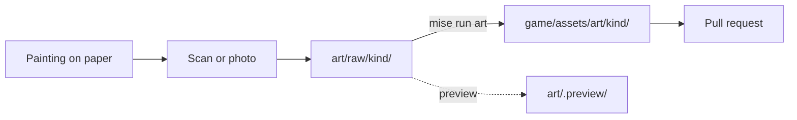

# Art pipeline

Status: agreed · Owner: ggagosh · Updated: 2026-11-02

Our painter works on paper and is also a developer on the team, so he runs this whole pipeline himself, with an agent's help if he wants it. This is how a painting becomes a game asset.

- **Painter's brief:** [painter-brief.html](painter-brief.html), also published as a shareable page at https://claude.ai/artifact/VLtcE2MYLmRaciGfVX5Qmi. The file in this repo is the source; republish the page after editing it.

## From paper to game

1. **Paint.** Follow the frame sizes in the brief, painting 1 cm past the pencil frame.
2. **Digitize.** Scan at **300 dpi** and save as JPEG at high quality, or photograph as the brief describes. For the A3 map, use a scan or a phone camera of 48 MP or more; a 12 MP photo of A3 comes out just under the export size.
3. **Drop it in** `art/raw/<kind>/`, with an English, lowercase name (see [art/README.md](../../art/README.md)). Committing through git or uploading on GitHub (Add file → Upload files) both work. These originals stay in the repo, so we can redo any conversion later.
4. **Convert:** `mise run art`, or `mise run art -- art/raw/portraits/max.jpg` for one file. For each file it:
   - balances the colors, using the paper as the white reference;
   - finds the painted area, straightens it (photos taken at an angle too), and cuts off the 1 cm bleed;
   - for icons, finds each drawing on the sheet and makes the paper transparent;
   - resizes the result to the export size and writes a PNG.
5. **Check the crop** in `art/.preview/` (the detected outline is drawn in red), and look at the result in `game/assets/art/`. If the crop is wrong, put the corners in `art/art.toml`, or ask an agent: *"Look at art/raw/portraits/max.jpg and its preview, and fix its corners in art/art.toml."*
6. **Check it in the game:** `mise run import`, then `mise run play`.
7. **Open a pull request** with the raw file and the exported PNG together (branch `art/<what>`, like `art/portrait-max`), so the other person can review it in the game before merging.

## Sizes and names

| Kind | Raw folder | Export size (px) | Exported as |
|---|---|---|---|
| City map | `art/raw/map/` | 3840 × 2160 | `map_<name>.png` |
| Story scene | `art/raw/scenes/` | 2560 × 1440 | `scene_<name>.png` |
| Portrait | `art/raw/portraits/` | 1200 × 1600 | `portrait_<name>.png` |
| Icon | `art/raw/icons/` | 256 × 256, transparent | `icon_<name>.png`, names from `art/art.toml` |

- Names are lowercase English `snake_case`, with no spaces. Story scenes start with their number: `01_pulse.jpg`.
- When a painting is redone, replace the raw file under the same name and run `mise run art` again. The game picks up the new version.
- At 300 dpi, every frame in the brief scans larger than its export size, so exports are only ever scaled down.
- The sizes live in `tools/art.py` (`KINDS`). Change them there and here together.
