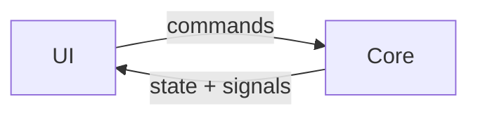

# Code conventions

Status: agreed · Owner: ggagosh · Updated: 2026-11-02

## Layout

```
game/
  core/    simulation: rules, state, AI. Plain RefCounted classes. No Nodes, no scenes.
  ui/      scenes and scripts that show the state and send the player's commands
  data/    content and tuning numbers: districts, events, costs
  assets/  imported art, audio, fonts
  tests/   headless tests
```

## The architecture rule: core never touches UI



The UI reads the state and calls commands on the core. The core never references a Node, a scene or the UI. Keeping it that way gives us:

- **Headless tests** for every rule.
- **AI-vs-AI simulations:** hundreds of games without a window, to check balance.
- **Save/load for free:** save the core state.

All randomness goes through one seeded `RandomNumberGenerator` owned by the game state, so any game, bug or simulation can be replayed exactly.

## GDScript style

- `gdformat` decides formatting (`mise run fmt`), and `gdlint` checks the rest. CI fails on either.
- Static types everywhere: `var gold: int`, `func pay(amount: int) -> bool`. Use `:=` when the type is obvious.
- Names: files and folders `snake_case`; `class_name` in `PascalCase`; nodes in `PascalCase`; constants in `UPPER_SNAKE`; signals in the past tense (`turn_ended`).
- Tabs for indentation (the Godot default).
- `##` doc comments on public classes and functions in `core/`.
- No magic numbers in `core/`: tuning values come from `game/data/`.
- Mark deliberate shortcuts with a `# ponytail:` comment that names the limit and when to upgrade, like `# ponytail: linear scan, fine below ~50 districts`.

## Tests

- Tests live in `game/tests/test_<area>.gd`, extend `"res://tests/test_case.gd"`, and use `func test_*()` methods.
- The checks are `check(ok, message)` and `check_eq(actual, expected, message)`. A script error inside a test also fails it.
- Name tests after the rule they cover: `test_r2_deviants_skip_pulse_slot`.
- Every numbered rule in a system doc gets at least one test. A bug fix starts with a test that reproduces the bug.
- Run them with `mise run test`.

```gdscript
extends "res://tests/test_case.gd"


func test_r1_pulse_happens_twice_a_day() -> void:
	var day := Day.new()
	check_eq(day.pulse_slots().size(), 2, "pulses per day:")
```

## Godot hygiene

- Commit `.gd`, `.tscn`, `.tres`, `.uid` and `.import` files. Never commit `game/.godot/`; it's a generated cache.
- Edit scenes in the editor when you can. Small text edits to `.tscn` files are fine.
- Rename or move files inside the Godot editor so references update. If a tool moved them, run `mise run import` and check that `mise run test` still passes.
