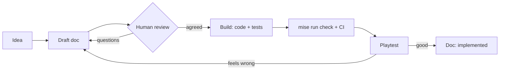

# Workflow

Status: agreed · Owner: ggagosh · Updated: 2026-11-02

How humans and AI agents build this game together.

## Who does what

| Humans | Agents |
|---|---|
| Decide what the game is and whether it's fun | Turn conversations into draft docs |
| Approve designs (`draft` → `agreed`) | Build from agreed docs: code and tests |
| Playtest | Run checks and simulations, fix, refactor |
| Direct the art | Clean up and import art |
| Review and merge | Review each other's work when asked |

Everyone keeps docs true.

## The loop

1. **Idea.** Talk it through with a teammate or an agent.
2. **Draft.** The agent writes or updates the doc from a template, listing open questions.
3. **Agree.** A human answers the open questions and sets `Status: agreed`.
4. **Build.** Brief an agent with the doc (see below). Code, tests and doc updates go in one change.
5. **Check.** `mise run check` locally; CI runs the same on every push and PR.
6. **Playtest.** A human plays it. Problems with feel go back into the doc, not into silent code tweaks.
7. **Done.** The doc moves to `Status: implemented`.

## Briefing an agent

Point at docs instead of retyping them. Say what's out of scope and what "done" means.

> Implement `docs/game/systems/pulse.md` (status: agreed). Keep the logic in `game/core/` and add a test for every numbered rule. Don't build UI yet. Run `mise run check`, and update the doc if anything had to change.

- One system or feature per brief.
- For bigger changes, ask for a plan first and approve it before any code.
- For design work: "Draft `docs/game/systems/economy.md` from the template, based on our conversation. List open questions; don't decide them."

## Git

- `main` always passes CI. Work on a branch: `feat/pulse`, `fix/raid-crash`, `docs/economy`.
- Keep pull requests small. Docs, code and tests for one feature go together.
- CI must pass before merging. Squash-merge.
- Commit messages: short and imperative, like "Add pulse timing to the turn loop".
- Agents commit, push and open PRs only when asked, and never push to `main` directly.

## Tasks

Use GitHub Issues for tasks and bugs, each linking the doc it relates to. Labels: `design`, `code`, `art`, `bug`.
