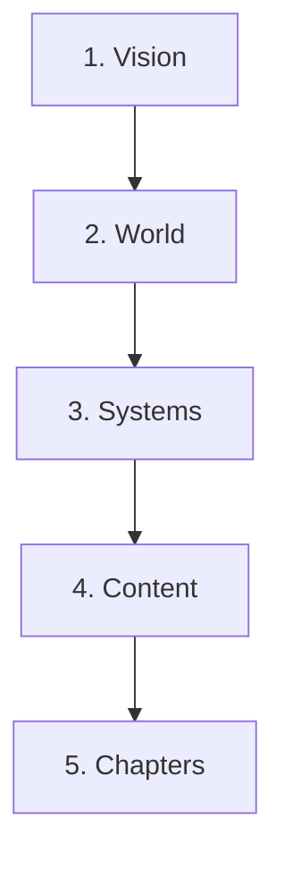

# Game design docs

Status: agreed · Owner: ggagosh · Updated: 2026-11-02

How the game is described. The docs come in five layers. Write top-down: each layer builds on the one above it, so don't detail a system before the vision is agreed.

| # | Layer | Lives in | Answers | Template |
|---|---|---|---|---|
| 1 | Vision | `vision.md` | What is the game? Why is it fun? What's in the MVP, and what's out? | [vision](../templates/vision.md) |
| 2 | World | `world.md`, `characters/`, `glossary.md` | Rules of the setting, factions, people, names | [character](../templates/character.md) |
| 3 | Systems | `systems/<name>.md` | One mechanic per file: its rules, numbers, AI and edge cases | [system](../templates/system.md) |
| 4 | Content | `districts/`, `events/` | The places on the map and the story cards | [district](../templates/district.md), [event](../templates/event.md) |
| 5 | Chapters | `chapters/<nn>-<name>.md` | The "levels": map, starting state, goals, scripted events | [chapter](../templates/chapter.md) |

## What a "level" is here

In this game a level is a **chapter**: one map, a starting situation, win and lose conditions, the story events that can fire, and usually one new system to learn. The MVP is chapter 1, the capital.

## Docs hold intent; data holds the final content

Docs describe what something is for and the rules it follows. Once a data format exists for something (events, districts, costs), the final text and numbers live in `game/data/`, and the doc links to the data file instead of copying it. This keeps one source for every fact.

## Writing tips by layer

- **Vision:** at most one page. Pillars are short statements that every feature must serve, such as "Every advantage costs suspicion".
- **World:** rules of the world, not history lessons. What does the player need to know to play?
- **Systems:** rules as a numbered list (R1, R2...), one testable sentence each. Give numbers as starting guesses in a table.
- **Content:** describe for two readers, the painter (what it looks like) and the player (what they can do there).
- **Chapters:** describe the arc of the chapter in turns: what the player learns early, the squeeze in the middle, the climax.

## Doc names

Lowercase, hyphens, English: `systems/police-ai.md`, `events/odri-falls.md`, `chapters/01-the-capital.md`.
